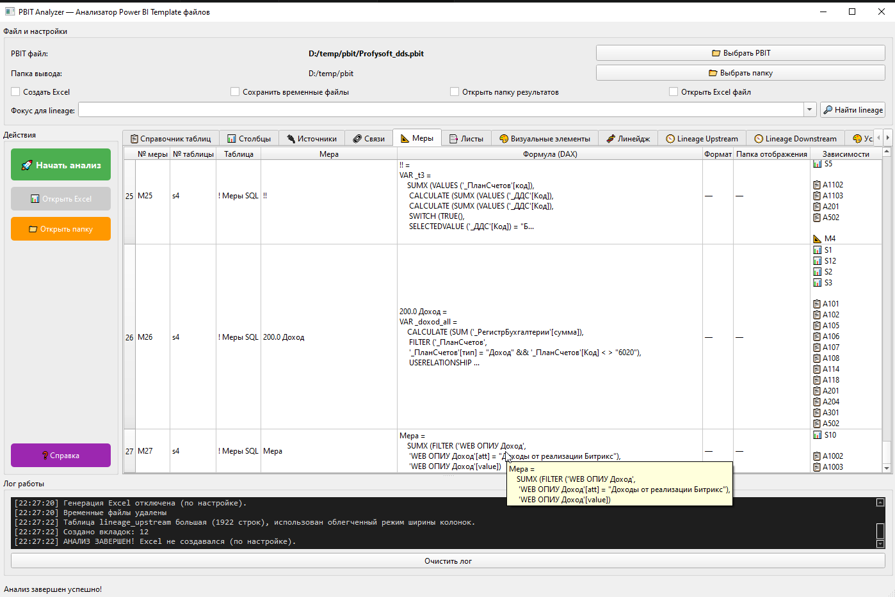
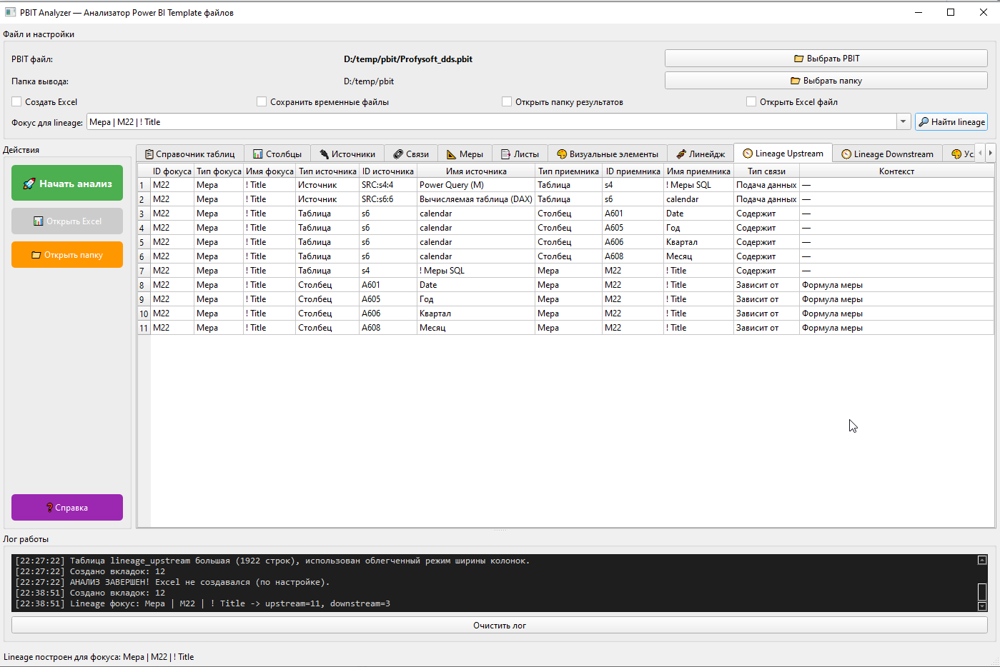

# PBIT Analyzer

Desktop-приложение для анализа файлов Power BI: шаблонов `Power BI Template` (`.pbit`)
и семантических моделей `.pbix`.
markdown




## Что делает

Поддерживаются два формата, формат определяется автоматически по расширению и содержимому:

**PBIT — шаблон с отчётом**

- распаковывает `.pbit` и читает `DataModelSchema` + `Layout`;
- извлекает таблицы, столбцы, меры, связи, источники;
- анализирует листы (включая размеры width x height), визуалы и условное форматирование;

**PBIX — семантическая модель**

- читает модель через [`pbixray`](https://github.com/Hugoberry/pbixray) (read-only, без Power BI Desktop);
- таблицы, столбцы, меры, вычисляемые столбцы/таблицы, DAX, Power Query (M), M-параметры;
- связи, RLS/OLS, статистика хранения (кардинальность, размеры);
- большие модели (от 500 МБ) читаются через `on_disk` — memory-mapped, без загрузки в RAM.

**Общее**

- показывает данные во вкладках GUI;
- опционально формирует Excel-отчет (по галке `Создать Excel`);
- строит lineage (общий и фокусный для выбранного элемента).

### Ограничения PBIX

- `pbixray` не разбирает слой отчёта: визуалов, страниц, закладок и условного форматирования у PBIX нет;
- строки данных (VertiPaq) не выгружаются — только метаданные модели;
- `.abf` и `.xlsx` (PowerPivot) не поддерживаются;
- PBIX без встроенной модели (Live Connection) не читается: приложение сообщит об этом.

В режиме PBIX вкладки «Листы», «Визуальные элементы» и «Условное форматирование» скрыты,
вместо них показаны «Параметры M», «Безопасность (RLS/OLS)» и «Статистика хранения».
Отдельных вкладок DAX и Power Query нет: выражения мер и вычисляемых столбцов уже есть
в «Мерах» и «Столбцах», а вычисляемые таблицы и M-код — в «Источниках».
Отдельной вкладки и листа Excel «Перспективы» тоже нет: данные остаются в результате
анализа (ключ `perspectives`), но в GUI и Excel не показываются.

## GUI: ключевые возможности

- все чекбоксы по умолчанию выключены;
- чекбокс `Создать Excel` управляет созданием `.xlsx`;
- чекбокс `Открыть Excel файл` работает только если Excel был создан;
- поле `Фокус для lineage` активно после завершения анализа;
- `Фокус для lineage` — выпадающий список с автодополнением и ручным вводом;
- кнопка `Найти lineage` пересчитывает `Lineage Upstream/Downstream` только для выбранного фокуса.

## Формат ссылок и ID

- ссылки на таблицы: `📊 S...` (например, `📊 S4`);
- ссылки на столбцы: `📋 A...` (например, `📋 A601`);
- ссылки на меры: `📐 M...` (например, `📐 M22`);
- ID визуала: `VIS_ID :<id>` (например, `VIS_ID :f48726d8e921d4f3f01f`).

## Формат элементов в "Фокус для lineage"

- общий формат: `Тип элемента | ID | Название`;
- для визуалов: `Тип элемента | ID | Тип визуала`;
- названия подтягиваются из соответствующих вкладок:
  - `Таблица` -> `Справочник таблиц`;
  - `Столбец` -> `Столбцы`;
  - `Мера` -> `Меры`;
  - `Визуал` -> `Визуальные элементы` (тип визуала).

## Требования

- Python 3.10+
- Windows (основной сценарий использования)
- `pbixray` устанавливается из `requirements.txt` (готовые wheels, компилятор не нужен)

## Установка

```bash
python -m pip install -r requirements.txt
```

## Запуск

Из корня проекта:

```bash
python run_gui.py
```

(старая точка входа `python _work\last_work_gui_work.py` тоже работает)

Примечание: авто-установка недостающих библиотек

## Запуск без GUI (headless)

`run_cli.py` выполняет тот же анализ, но без PyQt6 — подходит для серверов и скриптов.

```bash
python run_cli.py report.pbit                    # Excel рядом с .pbit
python run_cli.py report.pbix -o out             # PBIX: модель, Excel в out
python run_cli.py report.pbit --no-excel         # только анализ
python run_cli.py report.pbix --focus M22        # фокус lineage (S… или M…)
python run_cli.py report.pbix --on-disk          # читать модель через mmap
python run_cli.py report.pbix --in-memory        # всегда в память
python run_cli.py report.pbit --keep-temp -q     # временные файлы, без логов
python run_cli.py --self-test                    # проверить зависимости сборки
```

Коды возврата: `0` — успех, `1` — ошибка анализа, `2` — неверные аргументы или файл
не найден, `3` — неподдерживаемый/повреждённый файл или PBIX без встроенной модели.

## Сборка EXE

Вручную:

```bash
python -m pip install -r requirements.txt pyinstaller

python build_exe.py            # GUI + CLI
python build_exe.py --gui      # только GUI
python build_exe.py --cli      # только CLI (без Qt, заметно меньше)
python build_exe.py --dir      # папка вместо одного файла (быстрее запуск)
python build_exe.py --clean    # очистить build/ dist/ и .spec
```

То же самое через `create_exe.bat` — это тонкая обёртка над `build_exe.py`,
принимает те же флаги (`create_exe.bat --gui`, `create_exe.bat --cli`, ...).

Скрипт сам ставит недостающие зависимости, подставляет версию из `docs/CHANGELOG.md`
и копирует готовые `PBIT_Analyzer_GUI_v*.exe` / `PBIT_Analyzer_CLI_v*.exe` в корень проекта.
После сборки промежуточные `build/`, `dist/` и `*.spec` удаляются автоматически:
остаётся только готовый EXE в корне проекта. С `--no-copy` и `--dir` папка `dist/`
сохраняется — именно оттуда EXE забирает CI.
В GUI-сборку попадают `styles.qss`, `docs/schema_documentation.md` и `docs/CHANGELOG.md`,
поэтому справка и оформление работают и в EXE. В оба EXE включается `pbixray`
с бинарными декодерами — после сборки проверьте её командой
`PBIT_Analyzer_GUI_v*.exe --self-test` (или `PBIT_Analyzer_CLI_v*.exe --self-test`).

## Структура

- `run_gui.py` — точка входа GUI (корень проекта).
- `run_cli.py` — точка входа без GUI (headless).
- `build_exe.py` — сборка EXE через PyInstaller (после сборки чистит `build/`, `dist/` и `*.spec`).
- `create_exe.bat` — обёртка для `build_exe.py` с теми же флагами.
- `_work/last_work_gui_work.py` — исходная точка входа GUI с авто-установкой пакетов.
- `_work/pbi_modules/gui.py` — интерфейс и фоновый worker.
- `_work/pbi_modules/dispatcher.py` — фасад: выбор анализатора по формату файла.
- `_work/pbi_modules/file_kind.py` — определение PBIT/PBIX по расширению и содержимому.
- `_work/pbi_modules/analyzer.py` — сервис анализа `.pbit` (оркестрация).
- `_work/pbi_modules/extractors.py` — извлечение из `DataModelSchema` и `Layout`.
- `_work/pbi_modules/pbix_extractor.py` — адаптер `pbixray` → таблицы проекта.
- `_work/pbi_modules/pbix_analyzer.py` — сервис анализа `.pbix` (модель + lineage + Excel).
- `_work/pbi_modules/excel_report.py` — генерация Excel.
- `_work/pbi_modules/help_content.py` — HTML-текст справки.
- `_work/pbi_modules/help_dialog.py` — диалоговое окно справки с вертикальным скроллом.
- `_work/pbi_modules/formatters.py` — форматирование данных для отображения.
- `_work/pbi_modules/lineage.py` — построение графа зависимостей.
- `_work/pbi_modules/logging_config.py` — конфигурация логирования.
- `docs/` — документация: `schema_documentation.md`, `CHANGELOG.md`, `improvements.md` и планы работ.
